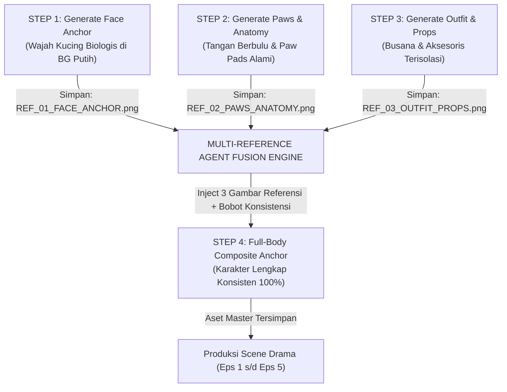

# SOP & PROTOKOL AGENT: MULTI-IMAGE REFERENCE CHARACTER CONSISTENCY (ANTI-AI-SLOP)

Dokumen ini adalah instruksi operasional untuk AI Agent Generator (Google Gemini Nano Banana 2.1 / ComfyUI IP-Adapter / Midjourney v6.1 / Multimodal Pipeline) untuk menghasilkan aset karakter yang **100% konsisten antar-shot** tanpa distorsi wajah, tanpa perubahan warna bulu, dan tanpa halusinasi kostum.

---

## 🧠 LOGIKA ARSITEKTUR 4-STEP AGENT GENERATION

---

## ⚙️ SPESIFIKASI BOBOT INJEKSI MULTI-REFERENCE (AGENT WEIGHTING)

Ketika Agent mengeksekusi Step 4 (Penggabungan Full-Body), gunakan pembagian bobot referensi berikut:
1. **Face/Identity Reference (`REF_01_FACE_ANCHOR.png`):**
   - **Weight:** `0.85 - 0.90` (High Priority).
   - **Tugas Agent:** Kunci 100% kontur kepala, warna bulu, pola belang/loreng, bentuk mata kucing, kumis, dan bekas luka.
2. **Anatomy/Paws Reference (`REF_02_PAWS_ANATOMY.png`):**
   - **Weight:** `0.70` (Medium Priority).
   - **Tugas Agent:** Terapkan tekstur bantalan cakar (*toe beans*) dan cakar tumpul pada seluruh jemari tangan.
3. **Garment/Style Reference (`REF_03_OUTFIT_PROPS.png`):**
   - **Weight:** `0.80` (High Priority).
   - **Tugas Agent:** Terapkan jenis bahan kain (twill denim, linen, wool, satin), warna, kerutan alami, dan aksesoris spesifik (liontin, kacamata, celemek).

---

## 📁 DAFTAR SOP PER KARAKTER
Setiap karakter memiliki berkas panduan eksekusi detail di foldernya masing-masing:
1. **Miko (Kucing Cowok Oren):** [`ASET_KARAKTER/MIKO/SOP_AGENT_GENERATE_MIKO.md`](file:///mnt/HDD-2/BACKUP%20LINUX/FILE%20DATA/DRACIN%20KUCING/ASET_KARAKTER/MIKO/SOP_AGENT_GENERATE_MIKO.md)
2. **Luna (Kucing Anggora Putih):** [`ASET_KARAKTER/LUNA/SOP_AGENT_GENERATE_LUNA.md`](file:///mnt/HDD-2/BACKUP%20LINUX/FILE%20DATA/DRACIN%20KUCING/ASET_KARAKTER/LUNA/SOP_AGENT_GENERATE_LUNA.md)
3. **Baron (Bengal Tycoon):** [`ASET_KARAKTER/BARON/SOP_AGENT_GENERATE_BARON.md`](file:///mnt/HDD-2/BACKUP%20LINUX/FILE%20DATA/DRACIN%20KUCING/ASET_KARAKTER/BARON/SOP_AGENT_GENERATE_BARON.md)
4. **Cleo (Siamese Socialite):** [`ASET_KARAKTER/CLEO/SOP_AGENT_GENERATE_CLEO.md`](file:///mnt/HDD-2/BACKUP%20LINUX/FILE%20DATA/DRACIN%20KUCING/ASET_KARAKTER/CLEO/SOP_AGENT_GENERATE_CLEO.md)
